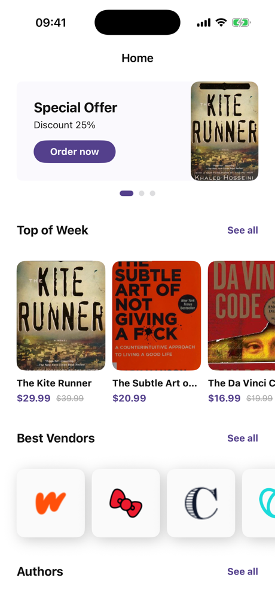
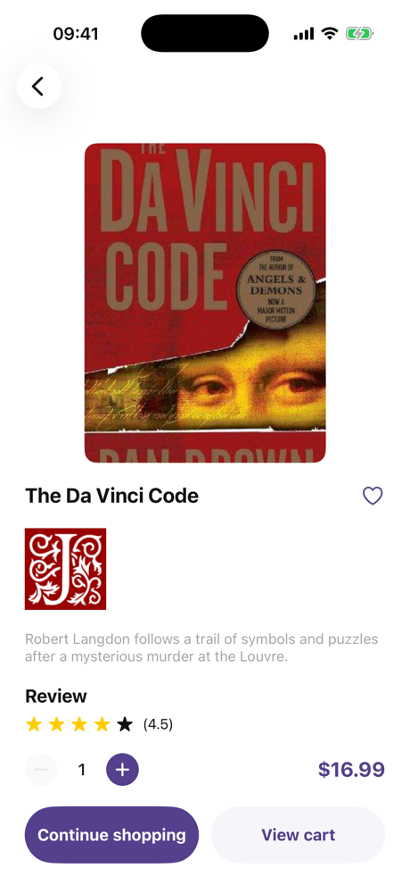
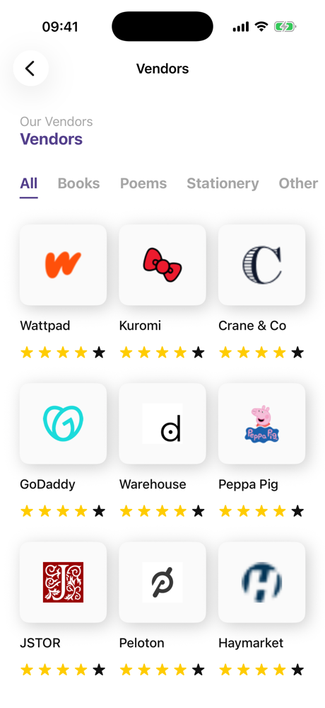
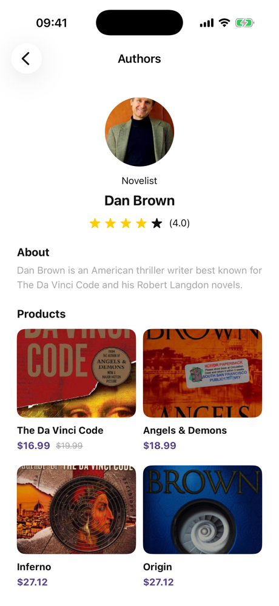

# books_app

A small SwiftUI bookstore app: special offers, top books, vendors, authors, and detail screens for books and authors. All data is mock data; images are loaded from the web.

## Screenshots

| Home | All books | Book detail |
|:---:|:---:|:---:|
|  |  |  |

| Vendors | Authors | Author detail |
|:---:|:---:|:---:|
|  |  |  |

## What we learned

### SwiftUI layout
- Building screens from `ScrollView`, `VStack`/`HStack`, `LazyHStack` for horizontal carousels, and `LazyVGrid` for two- and three-column grids.
- Breaking large screens into small computed subviews (`header`, `aboutSection`, `productsSection`) instead of one long `body`.
- Making reusable components (`BookCardView`, `VendorCardView`, `RatingView`, `SectionHeaderView`) that take a model instead of many separate parameters.
- Supporting both fixed and flexible widths in one component with an optional `width` (`nil` means "fill the grid column").
- A paged carousel with `TabView` + `.tabViewStyle(.page)` and a custom page indicator.
- A custom `ButtonStyle` (`CapsuleButtonStyle`) so buttons share one look without copy-pasted modifiers.

### State and data flow
- `@State` for local screen state (selected category, search text, quantity).
- `@Binding` to let a child view change its parent's state (`QuantitySelectorView`, `CategoryFilterView`).
- MVVM with `ObservableObject`, `@Published`, `@StateObject` (owner) and `@ObservedObject` (child screens).
- **Single source of truth.** Favorites are read from the view model (`viewModel.isFavorite(book)`), not from the copy of `Book` a screen received. Reading from the copy left the heart icon stale after tapping it.
- Keeping filtering logic in view models (`filteredAuthors(by:searchText:)`, `books(by:)`) so views only display data.

### Navigation
- `NavigationStack` with a typed path and one `AppRoute` enum, handled by a single `navigationDestination(for:)`.
- `NavigationLink(value:)` from any screen (cards, rows, the "Order now" button) instead of a separate `isPresented` flag per screen.
- `searchable` on the authors list and `@Environment(\.dismiss)` to close the book screen.

### Assets and resources
- Semantic color names in the asset catalog (`BrandPurple`, `TextPrimary`, `TextSecondary`, `CardBackground`, `OfferBackground`) and the symbols Xcode generates for them (`.brandPurple`), instead of string lookups like `Color("purpleColor")`.
- Loading remote images with [SDWebImageSwiftUI](https://github.com/SDWebImage/SDWebImageSwiftUI) via Swift Package Manager.

### Clean code
- One type per file, grouped into `Models`, `ViewModels`, `Navigation`, `Screens`, `Views`, and `Extensions`.
- `// MARK: -` sections (Properties, Body, Subviews, Helpers, Preview) in every file.
- Names that describe what a view is (`BookCardView`, `VendorLogoView`, `RemoteImageView`).
- A `#Preview` for every screen and component.
- Basic accessibility: VoiceOver labels for icon buttons, rating and quantity; header traits on section titles.

## Project structure

```
books_app/
├── BooksApp.swift
├── Models/          Book, Author, Vendor, Categories, MockData
├── ViewModels/      BookViewModel, AuthorViewModel, VendorViewModel
├── Navigation/      AppRoute
├── Extensions/      Double+Price
├── Screens/         Home, AllBooks, AllVendors, AllAuthors, BookDetail, AuthorDetail
└── Views/
    ├── Books/       BookCardView
    ├── Authors/     AuthorCardView, AuthorRowView
    ├── Vendors/     VendorCardView, VendorLogoView
    ├── Home/        SpecialOfferCardView, SpecialOffersSectionView
    └── Shared/      RemoteImageView, RatingView, QuantitySelectorView, CategoryFilterView, ...
```

## Requirements

- Xcode 26.4+
- iOS 26.4+

Open `books_app.xcodeproj` and run the `books_app` scheme. Swift Package Manager fetches SDWebImageSwiftUI automatically.
